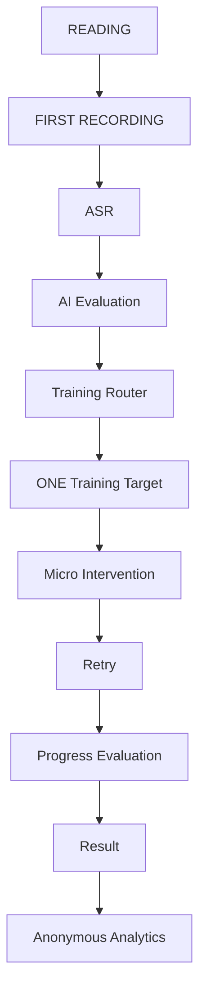
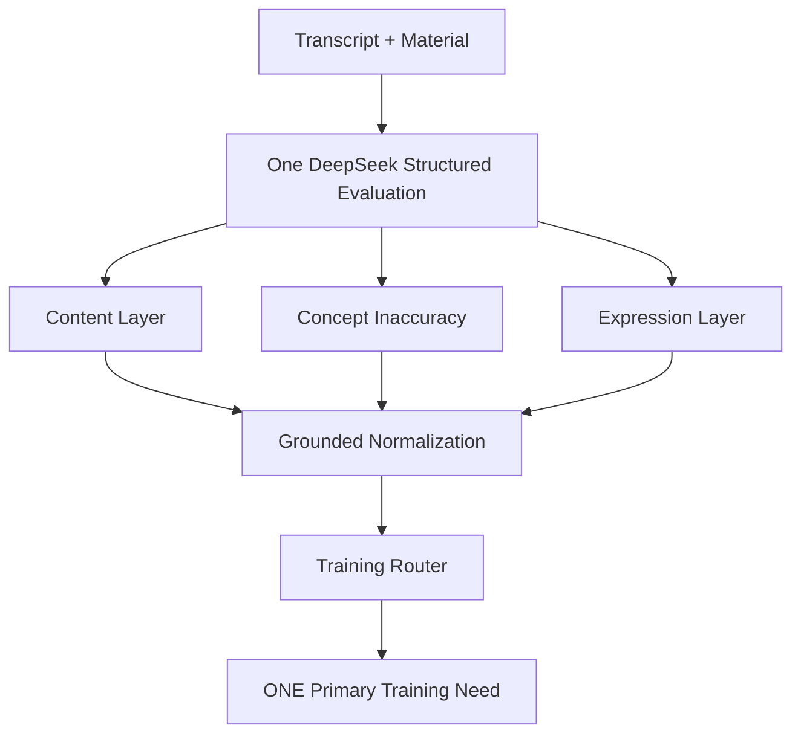

# SpeakNext

## One-line Introduction

SpeakNext is an AI-assisted spoken-expression training product that identifies the single most valuable issue in a user's response, provides a minimal targeted intervention, and verifies whether the user actually improves after retrying.

判断你这次最值得练什么，用最少提示让你自己改，再确认你是不是真的改好了。

- **Current stage:** Real-user testing completed for Information Reconstruction.
- **Stable baseline:** V0.5.10.3
- **Format:** WeChat Mini Program working prototype + AI product case study

## Demo / Product Preview

The repository does not currently include approved product screenshots. The intended preview set is documented in [`assets/screenshots/README.md`](assets/screenshots/README.md):

- Reading material
- Missing intervention
- Concept intervention
- Targeted sentence retry
- Progress result

No mock screenshots are presented as real product evidence.

## Why SpeakNext

Many speaking products return a total score, list several problems at once, or ask the user to “say it better” without making the next action clear. A second attempt is often scored again without checking whether the original problem was actually solved.

SpeakNext uses five product principles:

- train one issue at a time;
- do not manufacture a problem when the core task is already complete;
- provide the smallest useful intervention;
- let the user produce the improved expression;
- verify the original target after retrying.

## Product Loop



A first-round PASS goes directly to Result. Other production targets receive at most one retry, so one training session contains no more than two recordings.

## AI Diagnosis Architecture

Content, Concept, and Expression are diagnostic layers inside **one DeepSeek evaluation request per round**. They are not three separate model calls.



Current production taxonomy:

- `PASS`
- `MISSING_CAUSAL_STEP`
- `CONCEPT_INACCURACY`
- `WORDING_PRECISION`
- `FORMULATION_BREAKDOWN`
- `UNCERTAIN`

`INFORMATION_ORDER` and `LEXICAL_RETRIEVAL` remain in legacy and compatibility paths, but are not part of the current Information Reconstruction production routing taxonomy.

Grounded normalization requires user evidence to come from the transcript and material references to come from the configured material. The Router then selects one target rather than returning a list of issues.

## Retry Scope

| Scope | Training needs | User action |
| --- | --- | --- |
| `FULL_CONTENT` | `CONCEPT_INACCURACY`, `MISSING_CAUSAL_STEP`, `UNCERTAIN` | Retell the material again |
| `TARGET_EXPRESSION` | `WORDING_PRECISION`, `FORMULATION_BREAKDOWN` | Retry only the target sentence |
| No retry | `PASS` | Go directly to Result |

Wording and formulation interventions do not require the user to repeat the whole material.

## Progress Evaluation

The Progress Resolver does not simply assign another score. It asks:

> Did the specific issue selected in the first round actually improve?

Examples of the resulting safeguards:

- a natural wording paraphrase can resolve `WORDING_PRECISION`;
- a completed target sentence can resolve `FORMULATION_BREAKDOWN`;
- Concept distinguishes still wrong, corrected, and corrected-but-incomplete;
- removing the target content does not count as improvement;
- for `UNCERTAIN`, becoming evaluable does not mean the user has improved—the second round must reach an acceptable completed state.

## Real-user Iteration

Two exploratory real-user rounds were completed with anonymous participants U01–U10. Findings led to grounded feedback compression, missing-target questions, targeted sentence retry, target-retention checks, Concept feedback closure, Missing target alignment, and stricter UNCERTAIN progress semantics.

This is qualitative product discovery, not a claim of real-world model accuracy. See [`docs/user-testing.md`](docs/user-testing.md).

## Evaluation Approach

The repository separates:

- deterministic and mocked regression tests;
- structured evaluation fixtures;
- real-device validation;
- qualitative real-user validation.

All current deterministic regression suites pass. These checks protect known invariants; they are not a substitute for representative human-labeled accuracy evaluation. See [`docs/evaluation-framework.md`](docs/evaluation-framework.md).

## Tech Stack

- WeChat Mini Program
- JavaScript
- Node.js Cloud Functions
- WeChat CloudBase and CloudBase Database
- Tencent Cloud ASR
- DeepSeek structured JSON evaluation
- deterministic, mocked, and regression test suites

## Repository Structure

```text
.
├─ cloudfunctions/                 # ASR/evaluation orchestration and analytics ingestion
├─ components/                     # Mini Program UI components
├─ config/                         # Client-safe product metadata and CloudBase configuration
├─ data/                           # Six Information Reconstruction materials
├─ docs/                           # Product, architecture, eval, testing, privacy and roadmap
├─ eval/                           # Deterministic and optional live-eval harnesses
├─ mock/                           # Development-only fixtures
├─ pages/                          # Mini Program pages
├─ test/                           # Mini Program regression tests
├─ utils/                          # Stores, service adapters, presenters and analytics client
├─ assets/screenshots/             # Screenshot plan; no fabricated screenshots
├─ app.js / app.json / app.wxss
└─ CHANGELOG.md
```

## Local Setup

1. Import the repository into WeChat Developer Tools.
2. Select or configure a CloudBase environment.
3. Configure cloud-function environment variables from [`.env.example`](.env.example); do not commit actual values.
4. Deploy `analyzeSpeech` and `trackRetellingEvent` with cloud dependencies installed.
5. Compile and test on a real device with microphone permission.

Cloud credentials belong in the cloud-function environment, never in Mini Program source code.

## Documentation

- [Product overview](docs/product-overview.md)
- [Information Reconstruction V0.5](docs/information-reconstruction.md)
- [Architecture](docs/architecture.md)
- [Evaluation framework](docs/evaluation-framework.md)
- [Real-user testing](docs/user-testing.md)
- [Iteration log](docs/iteration-log.md)
- [Privacy and data](docs/privacy-and-data.md)
- [Roadmap](docs/roadmap.md)
- [Changelog](CHANGELOG.md)

## Current Scope

V0.5.10.3 is the stable Information Reconstruction baseline. V0.6 Structured / Logical Expression and V0.7 Adaptive Coach Agent are roadmap items, not current production capabilities. There is no production Agent or multi-model routing architecture in this version.

## License

No LICENSE has been selected yet. A license decision is required before public reuse terms are clear.
