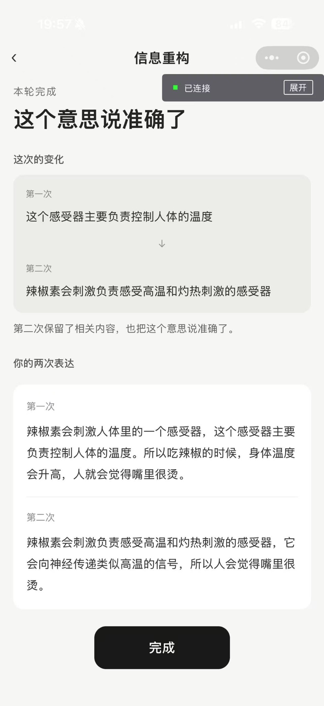
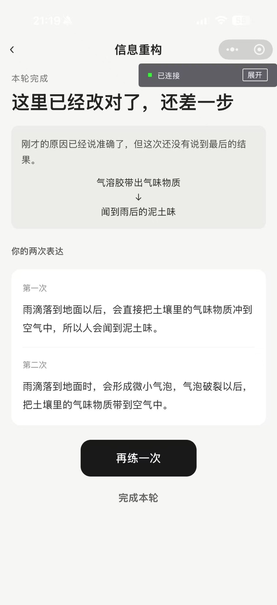
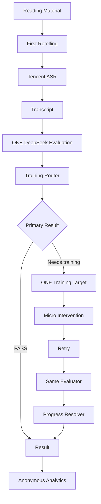
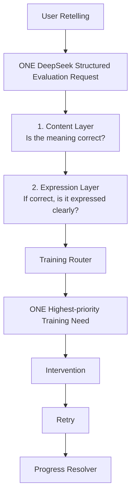

# SpeakNext

SpeakNext is an AI-assisted spoken-expression training product that identifies the single most valuable issue in a user's response, provides a minimal targeted intervention, and verifies whether that issue actually improves after retrying.

> 判断你这次最值得练什么，用最少提示让你自己改，再确认这个问题是不是真的改善了。

**Current module:** Information Reconstruction  
**Stable baseline:** V0.5.10.3  
**Status:** Working WeChat Mini Program · two rounds of exploratory real-user testing · U01–U10

## Product Preview

<table>
  <tr>
    <td align="center" width="33%">
      <strong>1. Read &amp; Retell</strong><br><br>
      <br><br>
      用户阅读一段材料，用自己的话复述核心意思。
    </td>
    <td align="center" width="33%">
      <strong>2. Diagnose One Issue</strong><br><br>
      <br><br>
      系统只选择当前最值得训练的一个问题，不一次返回问题清单。
    </td>
    <td align="center" width="33%">
      <strong>3. Targeted Retry</strong><br><br>
      <br><br>
      局部表达问题只重说目标句，不要求整篇重来。
    </td>
  </tr>
</table>

<table>
  <tr>
    <td align="center" width="50%">
      <strong>4. Verify Improvement</strong><br><br>
      <br><br>
      第二次表达后验证原训练目标是否真的改善，而不是重新给一个总分。
    </td>
    <td align="center" width="50%">
      <strong>5. Partial Improvement</strong><br><br>
      <br><br>
      即使原问题已修正，如果整体任务仍未完成，也不会直接判成功。
    </td>
  </tr>
</table>

## Why SpeakNext

Many AI speaking products stop at evaluation: they assign a score, list several problems, or ask the user to “say it better.”

SpeakNext instead turns diagnosis into a training loop:

**Diagnose one issue → give the smallest useful intervention → let the user retry → verify whether that original issue improved.**

The product follows five principles:

- one issue at a time;
- no forced intervention when the task is already complete;
- the smallest useful hint;
- the user produces the improved expression;
- the original target must be verified after retry.

## How It Works



A first-round `PASS` goes directly to Result without an intervention. Every other production target receives at most one retry, so a session contains no more than two recordings.

## AI Diagnosis Architecture

Content and Expression are evaluated together in **ONE DeepSeek structured evaluation request per round**. Their vertical order below represents product decision priority, not multiple model calls.



The vertical layer order represents decision priority, not separate model calls. Content and Expression outputs are produced within the same DeepSeek evaluation request.

### Content Layer — Is the meaning correct?

The Content Layer checks whether the user actually reconstructed the core meaning:

- `MISSING_CAUSAL_STEP` — key content or a required causal step is missing;
- `CONCEPT_INACCURACY` — the central concept is expressed inaccurately;
- incorrect causal or semantic relations — key ideas are connected in the wrong way;
- `UNCERTAIN` — current evidence is insufficient for a reliable judgment.

Concept inaccuracy belongs to the Content Layer; it is not a separate peer layer.

### Expression Layer — If the meaning is correct, is it expressed clearly?

The Expression Layer only becomes the training focus after the meaning is sufficiently correct:

- `WORDING_PRECISION` — the understanding is correct, but a local phrase is vague or imprecise;
- `FORMULATION_BREAKDOWN` — the user knows what to express, but the sentence is visibly incomplete or breaks down;
- `NONE` — no expression-level intervention is needed.

It does not score fillers, general fluency, or stylistic polish.

### Training Router

The same structured evaluation can produce multiple diagnostic candidates, but the **Training Router only selects ONE primary training need**. SpeakNext does not show every detected issue to the user; one round trains one problem.

No intervention is created when the routed result is `PASS`.

## Retry Scope

Not every problem requires the user to repeat the whole material.

| Scope | Training needs | User action |
| --- | --- | --- |
| `FULL_CONTENT` | `CONCEPT_INACCURACY`, `MISSING_CAUSAL_STEP`, `UNCERTAIN` | Retell the material again |
| `TARGET_EXPRESSION` | `WORDING_PRECISION`, `FORMULATION_BREAKDOWN` | Retry only the target sentence |
| No retry | `PASS` | Go directly to Result |

## Progress Evaluation

The second attempt is not simply scored again.

Progress Resolver asks:

> Did the original training target actually improve?

Representative safeguards:

1. **Wording:** a natural, more precise reformulation can resolve `WORDING_PRECISION`.
2. **Concept:** the concept can be corrected while other core content remains missing—so the original issue improved, but the round is still incomplete.
3. **Uncertain:** if the second attempt changes from “cannot judge” to a clear Missing diagnosis, the target is **not** resolved.

**Model became evaluable ≠ user improved.**

## Real-user Iteration

SpeakNext has completed two exploratory rounds of real-user testing (U01–U10).

Representative findings:

- local expression problems should not require full retelling;
- users need to know exactly what content is missing;
- grounded user evidence must survive the diagnosis → Router → UI chain;
- a confusing hint can originate from a wrong diagnosis target, not only bad copy;
- “the model can now judge the answer” does not mean “the user improved.”

This was qualitative product discovery, not an effectiveness experiment or a claim of real-world model accuracy. See [Real-user testing](docs/user-testing.md).

## Evaluation Approach

The repository separates four kinds of evidence:

- deterministic regression tests for contracts and invariants;
- mocked evaluation for structured model outputs and edge cases;
- real-device validation of the complete Mini Program flow;
- qualitative real-user validation of product behavior and comprehension.

All current deterministic regression suites pass. This does not imply 100% model accuracy or representative real-world performance. See the [Evaluation framework](docs/evaluation-framework.md).

## Tech Stack

- WeChat Mini Program
- JavaScript
- Node.js Cloud Functions
- WeChat CloudBase and CloudBase Database
- Tencent Cloud ASR
- DeepSeek structured JSON evaluation
- deterministic, mocked, and regression test suites

## Repository Structure

```text
.
├─ cloudfunctions/                 # ASR/evaluation orchestration and analytics ingestion
├─ components/                     # Mini Program UI components
├─ config/                         # Client-safe product metadata and CloudBase configuration
├─ data/                           # Six Information Reconstruction materials
├─ docs/                           # Product, architecture, eval, testing, privacy and roadmap
├─ eval/                           # Deterministic and optional live-eval harnesses
├─ mock/                           # Development-only fixtures
├─ pages/                          # Mini Program pages
├─ test/                           # Mini Program regression tests
├─ utils/                          # Stores, service adapters, presenters and analytics client
├─ assets/screenshots/             # Real product screenshots used in this README
├─ app.js / app.json / app.wxss
└─ CHANGELOG.md
```

## Documentation

- [Product overview](docs/product-overview.md)
- [Product Requirements — Information Reconstruction V0.5](docs/PRD-information-reconstruction-v0.5.md)
- [Information Reconstruction V0.5](docs/information-reconstruction.md)
- [Architecture](docs/architecture.md)
- [Evaluation framework](docs/evaluation-framework.md)
- [Real-user testing](docs/user-testing.md)
- [Iteration log](docs/iteration-log.md)
- [Privacy and data](docs/privacy-and-data.md)
- [Roadmap](docs/roadmap.md)
- [Changelog](CHANGELOG.md)

## Local Setup

1. Import the repository into WeChat Developer Tools.
2. Select or configure a CloudBase environment.
3. Configure cloud-function environment variables from [`.env.example`](.env.example); do not commit actual values.
4. Deploy `analyzeSpeech` and `trackRetellingEvent` with cloud dependencies installed.
5. Compile and test on a real device with microphone permission.

Cloud credentials belong in the cloud-function environment, never in Mini Program source code.

## Current Scope

V0.5.10.3 is the stable Information Reconstruction baseline. Structured / Logical Expression and an Adaptive Coach Agent remain roadmap ideas, not current production capabilities. This version does not use a production Agent or multi-model routing architecture.

## License

No LICENSE has been selected yet. A license decision is required before public reuse terms are clear.
