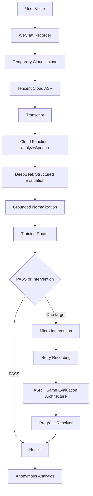
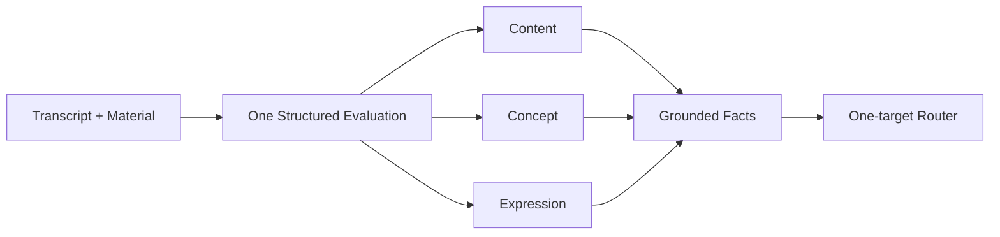

# Product Architecture

## Evaluation Layers

One DeepSeek request produces structured observations for Content, Concept, and Expression. Grounded normalization validates evidence before the Training Router selects one primary target.

## Call Boundaries

- First round: one DeepSeek evaluation request.
- Second round, when required: one DeepSeek evaluation request.
- Tencent ASR runs separately for each recording.
- Progress Resolver is deterministic and does not add an LLM call.
- Analytics is fail-open and cannot block training.

## Current Non-goals

There is no production Agent, RAG, long-term memory, or multi-model routing. Multi-model work appears only as a future evaluation-harness direction.
